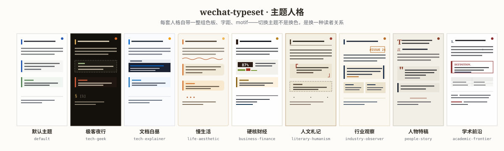

# wechat-typeset

> 写 Markdown，看手机预览，一键复制进公众号——不登账号、不跑后端，草稿存在本地不丢。

[](LICENSE)
[](package.json)

<p align="center">
  
</p>

**[在线编辑器](https://lync-cyber.github.io/wechat-typeset)** — 无需安装，浏览器打开即用。

---

## 亮点

**面向写作者**

- **预览即剪贴板** — 左侧 Markdown，右侧 375 px 手机预览实时同步；点「一键复制」回公众号粘贴，所见即所粘，没有"预览好看、粘贴塌版"。
- **18 套主题，一套一种气质** — 不只换色板，每套是一整组配色、字距、装饰图形与版式骨架。技术稿、财经周刊、人物特稿、生活随笔各有所属，切主题不塌版。
- **公众号高频版式开箱即用** — 提示块、金句卡、步骤卡、对比块、刊头、目录、KPI 仪表盘 ... 在 Markdown 里一行声明即可，主题决定渲染样式。
- **纯前端零外传** — 草稿落本地，不登账号、不跑后端、不加分析。分享走 URL 编码，把内容直接塞进链接里，发出去即载入只读草稿。

**面向 LLM / Agent 集成**

- **四个 Claude Skill 即插即用** — 路由 / 设计主题 / 可选保守标注 / 渲染导出，普通 Markdown 可直接套主题；需要特殊呈现时再加排版块。
- **MCP Server 一行起跑** — `npx -p @wechat-typeset/mcp wechat-typeset-mcp`，与 Claude Desktop / Cursor 直接对接。
- **可作 Node 库 / 命令行使用** — 同一份引擎，三种形态分发，schema 同源、JSON in / JSON out。
- **机器可读的能力清单** — 一份订阅即可获悉全部主题、容器、变体、平台约束与错误码，自描述、可钉版本。

详细的入口、配置与契约说明见 [LLM / Agent 集成指南](docs/README.md#llm--agent-集成)。

---

## 快速开始

**只想发一篇公众号文章** — 打开 [在线编辑器](https://lync-cyber.github.io/wechat-typeset)，左侧粘 Markdown，右侧切主题看预览，点「一键复制」回公众号粘贴。

**想本地跑** —

```bash
git clone https://github.com/lync-cyber/wechat-typeset.git
cd wechat-typeset
pnpm install && pnpm dev      # http://127.0.0.1:5173
```

`pnpm build` 产出静态文件到 `dist/`，可上传任意静态主机。`pnpm test` 跑单测与端到端校验。更多命令见 [CONTRIBUTING.md](CONTRIBUTING.md)。

**想从代码里调用** —

```bash
pnpm add wechat-typeset
```

```ts
import { render } from 'wechat-typeset'

const { html } = render({ md: '# Hello', persona: 'tech-explainer' })
```

完整 API 与参数说明见 [主题作者指南 · 公共 API](docs/theme-authoring.md#公共-api给外部集成方)。

**想接到 Claude / Cursor / 其它 Agent** — 见 [LLM / Agent 集成指南](docs/README.md#llm--agent-集成)，含 Skill 挂载、MCP 配置、CLI 与公共契约订阅。

---

## 本地文件夹文章库

文章可以直接保存在磁盘上，Claude、本地编辑器和资源管理器都能读写。本仓库的文章统一放在根目录 `articles/`；在左侧「我的文章库」点击「打开文章文件夹」并选择这个目录，即可按标题搜索、打开或新建文章。连接后，这里会显示所选文件夹的名称。此功能仅支持 Chrome / Edge 等 Chromium 浏览器，需要通过 HTTPS 或 `localhost` / `127.0.0.1` 打开编辑器；其他浏览器会隐藏文件夹入口，原有浏览器草稿照常使用。

```text
articles/
  .writing-styles.json          # 可选：本库的写作风格配置
  2026-10-24-文章标题/
    article.md                 # YAML frontmatter + Markdown 正文
    images/
      cover.webp
  _archive/                    # 在资源管理器中移入，列表会跳过
```

每篇文章一个目录，目录名为 `YYYY-MM-DD-标题slug`，新建时重名会追加 `-2`。列表每次扫描一层文章目录生成，跳过 `_archive` 和以 `.` 开头的目录，不需要索引文件或 `meta.json`。浏览器会记住选中的文件夹；刷新或重新进入页面后，点击左侧「恢复访问」恢复读写权限。

`article.md` 可以直接由代理创建，头部示例：

```markdown
---
title: "文章标题"
digest: "用于公众号后台的摘要，最多 120 字。"
author: "作者名"
cover: "images/cover.webp"
source: "https://example.com/original"
date: "2026-10-24"
theme: swiss-grid
variants:
  admonition: pill-tag
writingStyle: deep-research
---

# 文章标题

这里是正文。


```

`title`、`digest`、`author`、`cover`、`source`、`date` 是发布信息：依次用于标题、摘要、署名、封面、原文链接和文章日期。在「发布准备」中修改标题、摘要、作者、原文链接或封面，会直接更新 frontmatter；标题和摘要可以分别复制到公众号后台。`cover` 从本篇 `images/` 中选择；摘要或封面未填写时，清单沿用正文首段、首图的推断。`theme` 与 `variants` 控制排版，`writingStyle` 绑定写作风格 ID；发布信息和写作风格字段不会作为正文渲染。

**保存与外部编辑。** 关联文件夹后，按 `Ctrl+S` 将当前文章写入 `article.md`，工具栏显示「已保存到文件」或「未保存」。停止输入 2 秒后，未写盘内容会备份到 localStorage；写盘成功即清除这份备份。窗口重新获得焦点或准备保存时会检查磁盘文件：仅磁盘有变化时自动载入；浏览器和磁盘都改过时，选择「载入磁盘版本」或「用当前内容覆盖」。没有关联文件夹的草稿继续保存在 localStorage。

**图片。** 向文件夹文章粘贴、拖入或上传图片，会复用压缩逻辑保存为 `images/<时间戳>.webp`，正文插入相对路径。代理也可把图片文件直接放入本篇 `images/` 并使用相对引用，带空格的 Markdown 图片路径使用尖括号或 URL 编码。预览前会读取本地图片并转成 data URI，预览和复制仍使用同一份 HTML，磁盘正文保留相对路径；找不到的图片会出现在发文清单中。普通浏览器草稿继续使用 base64 内联图片。

**写作风格。** 在「写作」或「发布准备」流程的「写作风格」下拉框为当前文章切换风格，选择会写入 frontmatter 的 `writingStyle`，随 `Ctrl+S` 一起保存。未指定时使用配置中的默认风格。点击「配置」可修改指引与检查规则、复制为新风格或设为默认，也可以「复制创作指令」交给代理写稿。「保存全部」会把已关联文章库的配置写入库根目录 `.writing-styles.json`；未关联文件夹时保存到浏览器。库中没有该文件时，先使用浏览器配置，再回退到内置默认风格；只有明确保存配置才会创建文件。损坏的配置会提示修复，外部修改后的配置需要重新载入后再保存。

---

## 18 套主题

切主题不只是换色，是换一整套配色、字距、装饰语言与版式骨架，连同一种读者关系一起换。在「排版」流程中选择主题即可即时切换，复制产物与预览完全同步。

| 适合写 | 主题 |
| --- | --- |
| 通用题材 | 默认 |
| 技术 / 工程 / 文档 / 学术 | 极客夜行、文档白昼、学术前沿 |
| 财经 / 行业 / 数据 / 电商 | 硬核财经、行业观察、数据简报、电商脉动 |
| 人文 / 文学 / 生活 | 人文札记、人物特稿、慢生活 |
| 编辑 / 设计 / 慢读 | 编辑刊、苏黎世栅格、粗野主义报刊、深夜电台 |
| 教育 / 公告 / 青年 | 教室课堂、公文公报、青年潮志 |

逐套主题的设计笔记（色板理由 / 拒绝坐标 / 签名动作）在 [docs/design/personas/](docs/design/personas/)；速览表与选型决策树见 [skills/_shared/references/personas.md](skills/_shared/references/personas.md)。

页面级覆盖可在 Markdown 头部声明：

```yaml
---
theme: swiss-grid
variants:
  admonition: pill-tag
---
```

---

## 排版块

Markdown 之外，公众号高频版式只需一行声明。主题自动决定渲染样式。

**提示块** — 四种状态：`tip` / `warning` / `info` / `danger`，形状区分而非仅靠颜色（色盲友好）。

```markdown
::: tip 小贴士
草稿自动保存在浏览器本地，关掉标签页再开还在。
:::
```

**金句卡** — 大字居中，带主题装饰引号。

```markdown
::: quote-card
预览好看、粘贴后塌——这种情况在 wechat-typeset 里是 bug，不是特性。
:::
```

**步骤卡** — 有序列表，数字徽章跟随主题风格。

```markdown
::: steps
1. 粘贴 Markdown 原文
2. 切主题、看手机预览
3. 点「一键复制」，回公众号粘贴
:::
```

**对比块** — 两列并排，外层四冒号，内层三冒号。

```markdown
:::: compare
::: pros 优点
- 无需登录，草稿在本地
:::
::: cons 限制
- 仅适配微信公众号
:::
::::
```

完整清单（作者卡、封面、分割线、推荐卡、二维码 ...）见 [基础契约](docs/contract/base.md)；刊物 / newsletter 版式（刊头、目录、Q&A、脚注、CTA ...）见 [pack:editorial](docs/contract/packs/editorial.md)；数据可视化（KPI 仪表盘、条形图）见 [pack:data-viz](docs/contract/packs/data-viz.md)。

---

## 为什么不用现有工具

公众号编辑器对样式有严格限制：很多 CSS 属性会被剥离或客户端覆盖，细描边会在服务端栅格化时消失。大多数"Markdown 转公众号"工具把这当成 bug 绕过去，结果是一套蓝色主题套在所有题材上——财经稿与生活随笔共用同一组标题样式。

wechat-typeset 把视觉气质当成一等公民处理。每套主题持有完整的视觉语言；微信平台约束在渲染管线内部统一处理，不由作者承担。约束与降级细则见 [平台现实](docs/contract/platform.md) 与 [降级合同](docs/contract/fallback.md)。

---

## 部署

构建产物（`pnpm build` 输出到 `dist/`）上传任意静态主机即可。仓库自带 GitHub Pages、jsDelivr CDN、Cloudflare Pages、Netlify 四个部署入口；配置与 `VITE_BASE` 说明见 [docs/README.md · 镜像部署](docs/README.md#镜像部署)。

---

## 参与贡献

提 issue / PR 前请阅读 [CONTRIBUTING.md](CONTRIBUTING.md)。新增主题流程见 [主题作者指南](docs/theme-authoring.md)。所有文档入口见 [docs/README.md](docs/README.md)。

---

MIT · © 2026 lync-cyber
