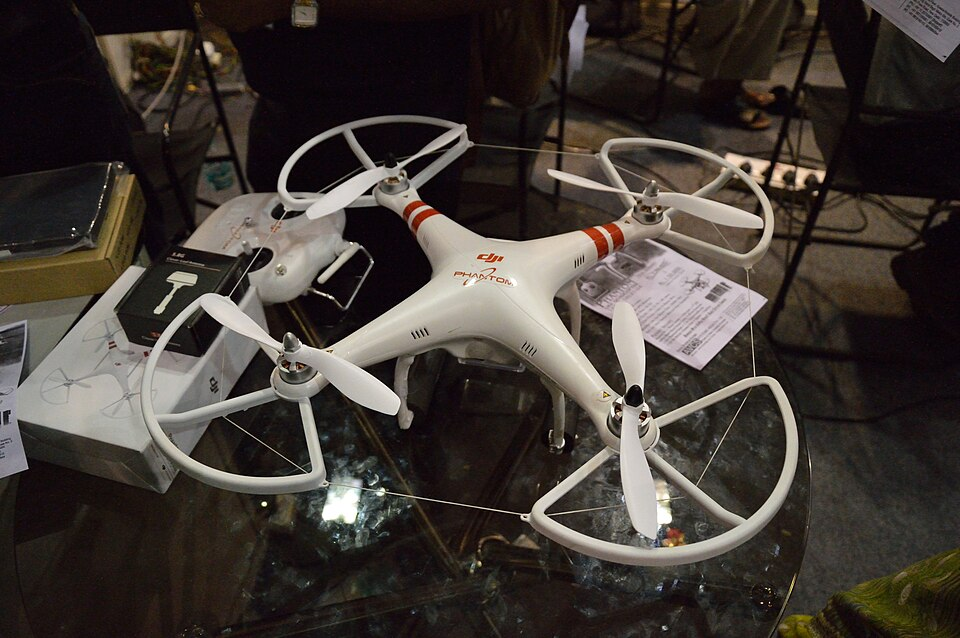
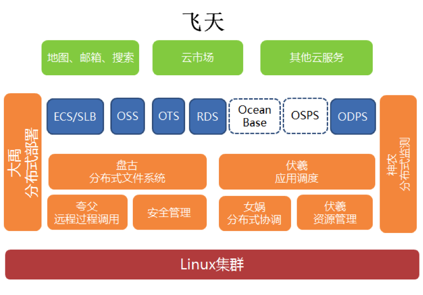

2013年1月，大疆发布了第一代“精灵”（Phantom）四旋翼飞行器。

如今看这件产品，很难理解它当年解决了什么了不起的问题：四个螺旋桨，一副白色机身，内置GPS和飞行控制系统，遥控器已经配置好参数，买回去就能飞。厂商公布的价格是679美元。

可在那个时候，想用多旋翼飞行器拍摄画面，用户往往需要购买零散部件，自己组装、焊接、调参，还得懂一点飞控知识。一个普通摄影爱好者，要先通过一道业余工程师资格考试，才有机会成为航拍用户。

大疆的技术原本主要服务专业航模和飞行器市场。精灵系列把这些技术装进一件不要求用户理解其内部复杂性的产品。

2013年的大疆产品公告里，反复强调的卖点是“无需调试、到手即飞”。这几个字听起来不够高深，却切中了市场扩张的关键：用户终于不必先学会当工程师。

*图1｜2013年9月加尔各答国际摄影器材展上陈列的第一代Phantom。飞控、GPS、遥控链路与机身已集成为一件面向普通使用者的产品。摄影：Biswarup Ganguly，Wikimedia Commons，CC BY 3.0。*

在研发人员看来，先进性常常意味着系统能做更多事，性能更高，控制得更精细。在客户那里，先进性有时意味着他终于可以少做一些事。

这种落差解释了许多令人不服气的商业结果。

## 为什么客户会选择一个你看不上的方案

工程师讨论产品，总喜欢把参数摆在同一张表上。效率、精度、速度、功耗、可靠性、功能覆盖率。比较方法清楚，结论也容易让同行信服。

采购部门看的却是另一张表。

报价多少？原来的设备能否继续用？更换系统需要停产几天？员工要不要重新培训？安装调试由谁负责？供应商如果倒闭了，谁来维护？

在一间工厂里，一套性能领先的新控制系统，可能输给使用了十年的旧方案。因为旧方案已经通过了客户内部漫长的验证，生产人员熟悉它，供应商每天都有人接电话。新系统提出的性能提升，未必足以覆盖重新认证与停机改造的成本。

对于开发者，这叫客户不识货。

对于采购负责人，可能恰好是一次谨慎而正确的决定。

产品进入市场以后，技术性能只是客户总成本的一部分。采购价格、安装成本、培训、替代风险、维修响应，以及未来几年出现问题的概率，都在决定那张订单最后落在哪里。

很多技术专家误以为，只要技术优势足够明显，商业优势总会自然出现。

现实往往比较无礼。你的方案在同行评审里拿到高分，在商业会议里却连最后一轮报价都进不去。

**客户购买的是改变现状之后的收益，还要承担改变本身的代价。**

这不是一条反技术的教训。能够降低复杂性、让普通用户不必具备专业能力的大疆精灵，本身恰恰依赖高水平的飞控和系统集成能力。技术仍然重要，但它要以客户能够感受到的方式发挥作用。

有时候，把一个产品做得更复杂，是工程师的成就；把同一套复杂性从用户面前拿走，才是商业产品的成就。

## 功能越多，未必越值得付钱

2014年，任正非谈华为消费者业务时，对手机研发中追求新功能的倾向提出过批评。他关注的一个问题是：开发了许多功能，真正使用的人却并不多。

这段来自一家高度重视研发企业的反思，比创业课上的“先做最小可行产品”更有说服力。

因为技术人员增加功能的理由往往是充分的。市场竞品有，自己也应该有；新算法能够实现，不实现似乎可惜；客户曾经提出过，提前做好就能增加中标机会。

问题是，竞争对手做过，不等于它创造了商业价值；客户说过想要，不等于有人愿意为它支付成本。

客户谈需求的门槛很低。你问一位潜在用户希望产品改进什么，他几乎总能提出三五项意见：界面再漂亮些，功能再多一些，最好还能免费集成另一套系统。

技术人员最容易把这些话当作需求规格书。回到办公室，修改计划，增加迭代周期。客户未必知道，他随口提出的一个兼容性要求，会让团队维护两套软件分支。

如果过几个月再问一次，他或许还有新的意见。

“用户希望有这个功能”是一句话；“客户愿意为这个功能增加采购预算”是另一件事。两者之间还有部门审批、供应商准入、负责人意愿，以及更多不方便写进需求文档的现实。

面向消费者的产品也类似。用户会称赞设计、夸奖体验、转发介绍，却未必安装、持续使用或付费。赞美是社交行为，支付才涉及实际的资源取舍。

创业者如果只收集表扬，很容易把一堆礼貌当成市场。

## 阿里云为什么可以先押注五千台服务器

当然，如果把上述逻辑推到极端，就会得出另一个危险结论：所有技术研发都必须先有现成订单，否则就是闭门造车。

阿里云的故事正好可以戳破这种简单认识。

2009年前后，阿里巴巴开始研发大规模分布式计算平台“飞天”。当时云计算还没有今天这样成熟的市场，工程团队需要长期解决集群管理、数据存储、任务调度和故障恢复等基础问题。

2013年8月，飞天完成单集群五千台服务器量级的技术突破。对于一般企业来说，把五千台机器组织成可稳定运行的计算系统，是一个长期且昂贵的工程目标。

但阿里不是在真空中幻想一个未来市场。其集团内部搜索、邮箱和数据处理业务，本身就拥有快速增长的计算需求。内部业务提供真实的负载、故障和成本约束，外部云服务则逐步扩展了平台的使用边界。

*图2｜2014年公开介绍的飞天技术架构：存储、调度、资源管理等底层能力组成长期的平台投资。来源：InfoQ《唐洪：阿里云飞天面对的三大挑战与解决策略》。*

这类基础设施有一道与普通工具软件不同的门槛：没有足够的系统能力，客户根本无法放心使用；一旦平台成为业务核心，能力、可靠性和生态反过来可以构成强大的竞争壁垒。

所以，技术先进性究竟能不能形成价值，要看行业的经济结构。

电商运营的小工具与大型分布式数据库，不可能按照同一种开发节奏推进。前者的风险常常集中在是否有人愿意持续使用，后者的风险还包括灾难恢复、长期运行和数据安全。药物、航空与复杂工业设备更不必说。

值得研究的并非产品该不该做完整，而是**哪些不确定性必须通过研发消除，哪些只能通过真实用户和客户消除。**

把前者当成后者来处理，就是用技术指标代替市场判断。

## 研发履历不会自动变成订单

一些技术创业者从最熟悉的东西出发：擅长算法就想卖算法，擅长硬件就想做整机，能完成复杂软件架构就想打造平台。

方向并没有错。积累多年的专业能力，是少数可以立即动用的创业资产。

麻烦在于，一个人常常把“我能做出什么”与“谁正在寻找这个东西”看成连续的两个步骤。前一件事情弄清楚之后，后一件似乎自然能够解决。

市场却不以研发者的技能表来组织自身。

客户的问题可能很不体面：一个Excel表格每天需要人工填写三遍，一套进口设备的维护报价太高，一个老系统的小接口迟迟没有人肯修改。解决办法未必值得写论文，却可能有人愿意马上付钱。

另一个看上去更宏大的技术方向，也许具有十倍的研发难度，潜在客户却没有明确的采购主体，项目预算迟迟无法落地。

工程师通常偏爱更有技术挑战的一项。商人可能先把手头的琐碎问题解决了。

这种选择差异无须被解释成谁更高明。技术壁垒可能带来长期回报，具体交易可以较早产生现金流。关键在于是否清楚自己承担的风险，以及公司靠什么活到价值兑现那一天。

成熟的技术人员还容易忽略另一件事：企业支付的不是技术本身有多稀缺，而是这份技术在给定条件下能替客户节省多少麻烦、增加多少收益、降低多少风险。

如果优势只能在同行讨论时被理解，商业关系就可能始终停留在同行讨论里。

一位工程师最初认为优秀的产品，往往是自己愿意签字认可的产品。经历真实客户之后，他可能逐渐理解另一种标准：客户愿意长期使用、采购部门敢于批准、现场负责人愿意承担实施责任。

有时这两个标准会在同一件产品上相遇。那是技术产业最令人满意的时刻。

更多时候，它们需要经过漫长、琐碎、并不那么光荣的协调。

市场从未承诺为某个产品的技术复杂性付款。它连“辛苦了”都不一定会说。

---

## 延伸阅读

- [大疆2013年1月7日：PHANTOM首发公告](https://www.dji.com/cn/newsroom/news/dji-launches-industry-best-easiest-to-fly-quadcopter-for-consumer-use)。
- [国家知识产权局：访大疆创始人汪滔（2016）](https://www.cnipa.gov.cn/art/2016/10/26/art_411_47214.html)。
- [任正非谈华为消费者业务（2014）](https://tech.sina.com.cn/t/2014-04-18/11319330121.shtml)。
- [阿里云开发者社区：飞天技术发展史](https://developer.aliyun.com/article/115901)。
- [阿里云开发者社区：飞天核心调度系统演进](https://developer.aliyun.com/article/881132)。
- [InfoQ：阿里云飞天面对的三大挑战与解决策略](https://www.infoq.cn/article/2014/10/aliyun-three-challenges)。
