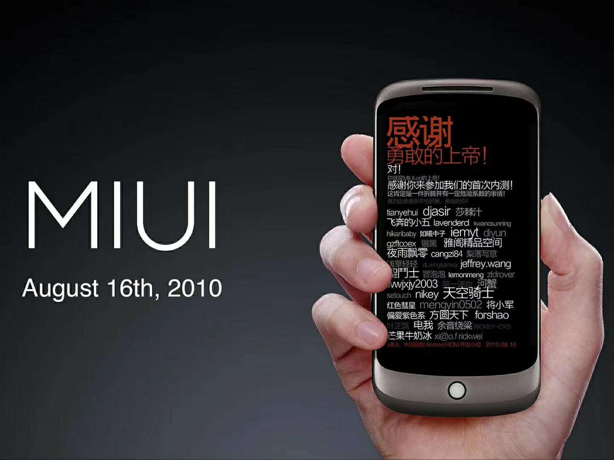
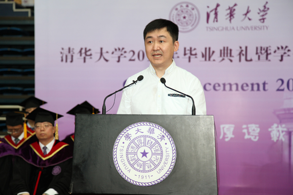

2006年前后，一个从事过机械工作的普通人，发现了中文互联网的一件小事。

那时，电脑上的拼音输入法经常打不出人们想要的词。可是把同样的拼音输进搜索引擎，却能得到相当接近的中文结果。他猜想，如果能利用搜索引擎积累的词汇和使用频率，输入法应该会好用得多。

这个人叫马占凯。

他没有一套开发完成的输入法，也不是当时国内互联网公司的技术负责人。他先给百度写邮件，介绍自己的想法。几封邮件发出去，没有得到实质性回应。他转而联系搜狗。

王小川后来在清华大学的公开演讲中回忆了这件事。搜狗团队认可了这个建议，马占凯进入公司，参与推动搜狗输入法的开发。2006年6月，搜狗拼音输入法推出首个公测版本；9月发布1.0正式版。

事后回顾，人们很容易把它概括成一个“发现用户痛点”的漂亮案例。但它最有意味的地方，发生在产品诞生之前。

**马占凯拿出去的，是一个尚未由自己实现的判断。**

他先让别人评价这件事值不值得做，再进入复杂的产品开发过程。他此前的工作背景，甚至不是最典型的互联网软件开发履历。

对于一些拥有多年软件与硬件研发经验，却还在等待产品“足够完整”才肯联系客户的人，这个故事多少有些刺耳。

## 第一次被当作普通供应商

技术人员并非不知道应该接触市场。他们可能读过不少创业书籍，对精益创业、客户开发、最小可行产品等术语也相当熟悉。

真正到了动手的时候，又开始踌躇。

介绍资料还不够精炼。功能还没有覆盖主要场景。客户可能提问自己尚未考虑过的兼容性问题。如果对方是一家有实力的企业，会不会认为这套产品太业余？

一个人可以独立承担极其复杂的技术工作，却不愿意以一个经验尚浅的销售者身份出现。

他曾经主持专家评审，现在需要请求陌生人安排一次见面；过去供应商准备材料请他审查，现在轮到他对着客户解释产品优势。技术能力并没有下降，座位却换到了桌子的另一侧。

成熟的专业人士尤其容易高估这种身份下降的代价。

第一次谈业务时表达生涩，报价没经验，听不懂采购部门的某个术语，都可能让人感到难堪。人在自己熟悉的领域积累了十几年资历，转身却要重新学习怎样向别人介绍自己，当然不会舒服。

麻烦是，商业经验并不存在一个无需见客户就能完成的训练场。

可以把这项工作推迟三个月，却很难通过独自修改代码，让第一次见客户的感觉变得自然。

这还不是最棘手的部分。有些技术专家第一次向客户开口，并没有真正准备听取答案。

他们带着一套论证充分的产品方案，希望对方承认它有价值。遇到质疑，习惯立即解释技术原理；听到功能建议，习惯记录为下一轮研发任务。

客户说了一堆话。开发者也做了不少笔记。

最后，双方仍未讨论出一件具体的事情：客户到底有没有足够重要的问题，需要花钱请别人解决？

## 一百个人，足够让一个系统开始改变

2010年，小米最初并没有自己的手机。

雷军在小米十周年演讲中回忆，团队先在开源Android系统的基础上研发MIUI，集中资源完成电话、短信、联系人和桌面等高频功能。

对于一套操作系统来说，这当然远远谈不上完整。

产品的第一批使用者是通过论坛招募来的。需要自己刷机，而且操作失误可能影响手机正常使用。最终有100个人愿意参加早期测试。

2010年8月16日，第一版MIUI发布。启动界面没有首先突出公司的标志，而是列出了这100位早期测试者的名字。

*图1｜小米官方社交账号回顾的MIUI早期启动画面，纪念首批100位测试用户。来源：Xiaomi HyperOS官方账号；版本日期及用户规模另见小米官方MIUI版本史。*

今天的小米拥有庞大的软硬件产品线，很容易让人忽略那个起点：他们并没有等待一台自行设计制造的手机出现，才开始寻找用户。

MIUI最初的反馈来自少量愿意承担刷机风险、愿意进入论坛表达意见的用户。团队以周为单位修改版本，逐步扩大使用者群体。

这与某些技术创业者最熟悉的工作方式有相似之处：频繁发布、记录缺陷、不断修正。但它有一个决定性的不同。反馈不是只来自开发者自己。

用户会把注意力放在工程师没有预料到的地方。有些开发者精心设计的功能无人提及，有些不起眼的细节却让用户每天抱怨。

更重要的是，这100名用户证明的事情非常有限：有人愿意花时间尝试、提出问题、继续使用。它还不能自动证明大规模手机市场一定成立，也不能代替后续供应链与商业模式的验证。

创业实践需要的恰恰是这种对证据的分寸感。每次获得一点新的认识，就决定下一笔投入应该多大。

## 见客户不是去寻找赞同

技术人员在工程实验里，通常能接受自己的假设被推翻。只要证据充分，模型就应该修正。

但创业者谈起自己的产品时，常常失去这种冷静。

他花了很长时间研究行业机会，搭建架构，购买设备。产品早已和未来收入、职业转型，以及对自己能力的期待纠缠在一起。

潜在客户说“没有需求”，他会觉得对方还没有理解产品。客户说“暂时没预算”，他开始解释技术领先的长期价值。实在不行，就继续增加功能，等待下一次再介绍。

这些解释有时成立。很多行业客户确实保守，采购周期也确实漫长。

但如果所有负面反馈都可以用“客户还不理解”解释，所谓市场验证就只剩下收集赞同。

研究创业决策的Camuffo等人曾把科学式决策方法引入真实创业团队。2024年，他们汇总四项随机对照实验，涉及759家企业。研究发现，采用科学方法检验商业假设的团队，更愿意终止缺乏前景的构想，战略调整也更倾向于有限而有依据，而非完全不变或不断激进转向。

这对技术人员有一点特别的讽刺：科学训练本来就是他们的长项。进入创业领域后，却可能把自己的商业设想放到实验之外。

很多项目的投入不是输在技术，而是迟迟不肯承认某项需求假设已经没有足够证据支持。

商业实验当然有边界。医疗器械、工业控制器和安全关键系统，不能为了获得反馈，就把不稳定的产品交到真实生产现场。

然而，客户工作流程、采购责任、现场问题和现有替代方案，可以远在正式交付之前就开始调查。对于早期产品，第一次有价值的接触甚至不需要演示设备。

你可以只有一张系统框图，或者一份针对客户具体问题的技术评估。谈话的重点放在对方目前如何解决问题、最昂贵的环节在哪里、谁有权批准预算，以及已经尝试过哪些替代方式。

某些问题一旦被解释清楚，技术专家甚至会发现：客户暂时不需要一套完整软件平台，只愿意购买一次诊断或一个小型定制模块。

这类业务没那么有技术理想色彩，却可以较早揭示客户愿意付费的边界。

## 把自尊从成本表里拿出去

有一类创业者可以拿着简单方案去找客户，获得意向后再组织采购、开发和交付。研发人员往往不太欣赏这种方式，认为它过于粗糙，甚至缺乏对工程风险的尊重。

这种质疑在涉及安全与交付责任时完全合理。把没有能力完成的工作卖出去，迟早会付出代价。

但技术人员也应该看见另外一面：有些人虽然没有做出复杂产品，却已经开始学习客户如何作出决定、交易怎样发生、项目交付有哪些阻力。

这是一类无法通过提高代码质量直接获得的知识。

对于习惯依靠专业能力获得尊重的人，最难接受的事实可能很简单：客户不认识你，也没有义务喜欢你。一个订单的谈判结果，不会决定你过去十几年是否有价值。

这种认识如果只停留在纸面上，很容易显得浅薄。它需要通过一次次真实接触才逐渐成立。

*图2｜王小川2016年在清华大学演讲时回顾搜狗输入法的诞生。公开叙述留下了一段细节：一位来自机械行业的提议者，先向互联网公司发出建议，随后参与产品开发。来源：清华校友总会。*

回看马占凯的邮件，最值得记住的倒不是哪家公司最初没有回复，而是一个普通人如何把自己的观察放到外部世界接受评价。

那时候他没有完整产品，提议也未得到所有人的认同。他只是觉得一个问题值得解决，于是找了能够解决它的人。

后来，参与这件事的技术团队拥有了规模庞大的产品。马占凯的一封邮件不会是成功的全部原因，后续研发、渠道和经营缺一不可。

但是，如果最初那个发现问题的人坚持先把输入法独立开发出来，等到界面完善、功能齐全、文档齐备，再开始联系互联网公司，故事很可能会有另一种走向。

一个做了十年专家的人，第一次卖东西时像个新手，没有什么稀奇。

在公司内部，有人为他的技术评审预订会议室；到了客户那里，他得自己争取二十分钟。这个差别，靠再做一个GUI解决不了。

客户可能只是说一句：“我们再考虑考虑。”

那一天没有产生订单。回到电脑前，他仍然可以继续修复一个程序缺陷。

但第二次联系客户时，他至少不必再猜测，第一次会是什么感觉。

---

## 延伸阅读

- [清华校友总会：王小川《和时间做朋友》](https://www.tsinghua.org.cn/info/1014/12117.htm)。
- [搜狗输入法官方2006年更新记录](https://pinyin.sogou.com/changelog.php)。
- [小米官方MIUI版本史](https://home.miui.com/)。
- [小米公司发展历程](https://www.mi.com/about/history?t=1429768706368)。
- [雷军2020年十周年演讲全文](https://finance.sina.cn/china/gncj/2020-08-11/detail-iivhuipn8125033.d.html)。
- Camuffo等（2024），[Scientific Approach to Entrepreneurial Decision-Making](https://doi.org/10.1002/smj.3580)。
