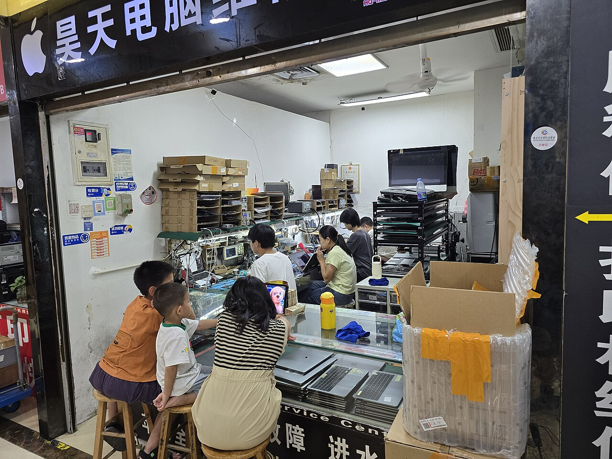
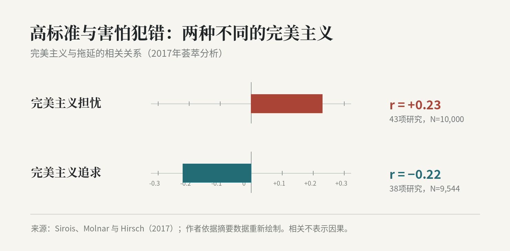

有一种项目，死不了，也活不过来。

电路板已经能正常工作，电机能稳定运转，核心算法经过了仿真和实测。控制环路里的异常被逐个排除，软件版本号更新了十几次。继续开发的理由仍然充分：调试界面不够友好，自动参数辨识尚未完成，不同客户使用的设备也需要适配。

如果找一位同行评审，他大概会认可这份工作清单。每一项都有技术依据，有些功能甚至能明显改善使用体验。

唯独有件事，在清单上很难找到：谁会买它？

并非没研究过市场。行业报告读过，竞争产品拆过，收费方式和市场规模也计算过。有时候，就连未来几年的产品路线图都画好了。真正需要发给潜在客户的第一封邮件，却仍然停留在草稿箱。

这幅图景不是某个创业者的独特经历。它说明了一种更隐蔽的职业冲突：一个人可以用非常熟练的专业劳动，回避自己最不熟练的工作。

## 实验室的失败，通常不会伤害工程师的身份

成熟的工程师并不缺乏承受失败的能力。

算法不收敛，电路板烧毁，系统在极端工况下出现异常，这些都是研发工作的组成部分。技术上的错误令人烦躁，但多半还在专业秩序之内。你可以重新设定参数、检查时序、修改模型、再做一轮实验。解决问题的过程，恰恰能够证明自己的专业能力。

客户的拒绝却没有这样清楚的因果链。

想象一次普通的业务接触：你认真介绍自己开发的系统，对方听了几分钟，说了一句“我们现在有合作供应商，暂时不考虑”。他或许只是说了句实话，也可能根本没有时间了解方案。

可对于开发者，这句话有时会被听成另一句话：你做了这么多年研发，这些东西原来并没有那么值钱。

在公司内部，他可能是某一领域的专家、评审会的主讲人，或者被年轻同事请教的对象。走进一间陌生公司的会议室，过去那套职级与声望忽然不再通用。对方甚至不会耐心听完技术方案，而是直接问：多少钱？出了问题谁来负责？为什么要换掉现有供应商？

一个人之前习惯评价别人，现在需要等待别人评价自己。令人局促的，往往是这个位置变化。

*图1｜深圳华强电子世界的一间维修店。维修、询价和客户沟通共处一个狭小空间，技术劳动与实际交易并没有天然的隔墙。摄影：Benlisquare，Wikimedia Commons，CC BY-SA 4.0，2025。*

多年专业训练带给人的，不止是知识储备，还有一种判断自身价值的方式。一个人熟悉自己在技术体系里的坐标，因而很难容忍自己在另一套体系里从零开始。

这种难堪无法通过增加功能来消除。可是增加功能，至少是一件马上就能做、而且做完之后一定能看见成果的事。

## 忙碌，可能是最体面的拖延

心理学研究为这种现象提供了一个比“太追求完美”更准确的解释。

2017年，Sirois等人在《欧洲人格心理学杂志》发表荟萃分析，区分了完美主义的两种倾向。一种是为自己设定高标准、追求卓越；另一种是过分担心犯错、在意负面评价。

研究发现，完美主义担忧与拖延呈正相关，平均相关系数为 **r=0.23**；完美主义追求与拖延则呈负相关，平均为 **r=−0.22**。前者汇集了43项研究、约1万人，后者汇集了38项研究、9544人。

*图2｜同样被称作“完美主义”，高标准追求和评价担忧却与拖延呈相反方向的相关。根据Sirois等（2017）荟萃分析摘要数据重绘。*

这组结果有一个耐人寻味的含义：认真、专业、要求高，并不会自动导致迟迟不行动。让人裹足不前的，可能是对不理想评价的过分在意。

研发人员说“产品还不够好”，这句话需要拆开理解。某项安全功能没有达到交付标准，是客观的研发缺口；希望客户第一次见到产品时就能被完整的界面、漂亮的功能列表和成熟的架构打动，则掺入了另一种诉求。

他希望自己以一个胜任者的形象出现，而不是以一个需要向别人打听需求的新手出现。

关于拖延的研究还有一个发现：人们回避令人不安的任务，有时是为了立即缓解情绪。读一篇技术论文、修复一个程序缺陷，能够很快恢复掌控感；发出一封业务邮件，可能三天都没有回音。

于是，越是能干的人，越有能力把回避伪装成建设性工作。他能独立实现足够复杂的系统，也就拥有几乎取之不尽的后续工作。

这里有一种创业叙事很少提到的奢侈：**有能力独自完成很多事情，恰恰使人可以长期不必请求别人参与。**

## 被高学历与专业头衔保护过的人

在中国的技术组织里，一个人的职业身份往往由学历、职级、成果和项目规模共同定义。

读完学位，进入大公司，承担关键研发任务，获得技术专家或管理岗位，负责审查方案——这是一条努力与回报大体可以相互解释的路径。多数时候，评价标准虽不完美，但足够熟悉。

创业却把这样的解释体系打散了。

一位资深专家可以在会议上被称作“老师”，也可以在客户那里只得到一条未读消息。客户未必关心他发表过多少论文、主持过多少项目，只在乎能否解决自己的问题，价格是否合理，以及供应商能否在需要的时候接电话。

技术行业内部认可的复杂性，在商业世界里经常没有定价权。

学历和履历仍有价值，可以帮助建立初步信任，解决高门槛问题，进入特殊行业。但它们无法代替交易关系。外部客户既没有参加你的晋升答辩，也没有义务为你过去的勤奋付费。

职业身份转换研究者Herminia Ibarra曾指出，新角色通常要经过实际尝试，才能逐渐形成稳定的身份认同。麻烦在于，尝试期间一个人的表现往往不够成熟。

对于工作十几年、早已习惯被当作专家的人，“不够成熟”尤其难以接受。

年轻销售去拜访客户，说话不熟练，可以被看作经验不足；资深工程师去谈第一笔技术服务，甚至会羞于承认自己不知道客户如何采购、不懂报价条款，也不了解如何推进合作。

他不愿意再做一次初学者。

于是许多人选择自己最体面的姿态：继续准备。行业调研做得非常深入，竞品分析非常严谨，原型工程漂亮得令人佩服。甚至每一次商业方向切换，都伴随着新的专业积累。

问题在于，这些积累究竟是在为哪一个客户解决问题？

## 没有客户的版本号

商业机会研究与技术研发当然可能需要几年甚至十几年的积累。芯片、药物、关键工业设备尤其如此。安全验证不能省，可靠性不能靠胆量弥补。

但技术研发不等于商业验证。一个产品暂时不能交付，并不妨碍开发者调查使用场景、采购流程、现有替代方案与客户的真实损失。越是严格的行业，越需要尽早了解认证、供应商准入和责任划分；这些信息很少能靠增加一段代码得到。

有的研发工作是在降低实际风险。有的研发工作，则是在保护一种可能性：只要还没有进入市场，就可以继续相信产品将来会成功。

这是漫长准备最隐蔽的心理收益。方案尚未上市，失败便尚未发生。未来仍然完整，哪怕每个月都在悄悄消耗时间。

*图3｜深圳华强电子世界。技术产品最后要进入由价格、替代品、交期和信用构成的真实交易秩序。图片：Wikimedia Commons，CC0。*

市场里随处可见不够精巧的产品，也有大量卖不出去的精巧产品。技术人员第一次认真研究这些场景，难免感到某种失落：过去被反复讨论的那些性能优势，原来不是客户判断的全部依据。

失落本身没有什么可耻。更值得警惕的是，一个人已经察觉评价体系变了，却仍旧把所有精力投向旧体系允许他得高分的地方。

那张项目清单可以一直加下去。GUI、参数辨识、配置向导、自动测试、平台重构，每项都值得开发。

而那封准备发给客户的邮件，仍在草稿箱里。

产品开发日志里没有记录它等待了多久。

---

## 延伸阅读

- Sirois, Molnar & Hirsch（2017），[完美主义与拖延荟萃分析](https://doi.org/10.1002/per.2098)。
- Sirois & Pychyl（2013），[Procrastination and the Priority of Short-Term Mood Regulation](https://doi.org/10.1111/spc3.12011)。
- Ibarra（1999），[Provisional Selves](https://doi.org/10.2307/2667055)。
- [Wikimedia Commons：华强电子世界维修店](https://commons.wikimedia.org/wiki/File:Laptop_repair_shop_at_Shenzhen_Huaqiang_Electronic_World.jpg)。
- [Wikimedia Commons：华强电子世界 1](https://commons.wikimedia.org/wiki/File:%E5%8D%8E%E5%BC%BA%E7%94%B5%E5%AD%90%E4%B8%96%E7%95%8C_1.jpg)。
